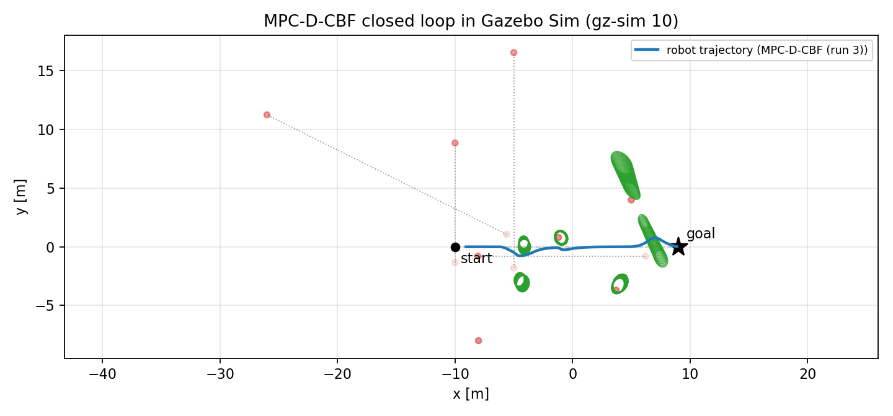
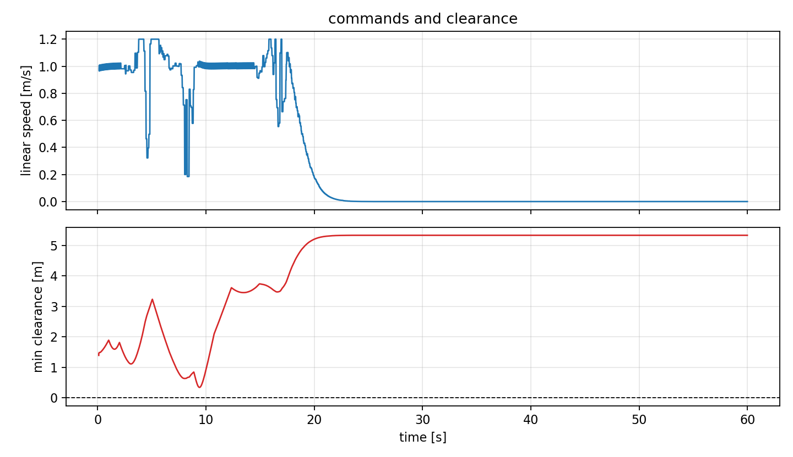

# MPC-D-CBF on ROS 2 + Gazebo Sim（论文复现与移植）



把 ICRA 2023 论文 **《Dynamic Control Barrier Function-based Model Predictive
Control to Safety-Critical Obstacle-Avoidance of Mobile Robot》** 的官方代码从
**ROS 1 Noetic + Gazebo Classic 11** 移植到 **ROS 2 Lyrical + Gazebo Sim 10.5**，
让它能在本机（Ubuntu 26.04，无 Docker、无 Gazebo Classic）上原生跑通，并复现论文的
仿真实验（安全避障轨迹 + Table I 指标）。

| 项目 | 内容 |
|---|---|
| 论文 | Zhuozhu Jian, Zihong Yan, Xuanang Lei, Zihong Lu, Bin Lan, Xueqian Wang, Bin Liang, *Dynamic Control Barrier Function-based Model Predictive Control to Safety-Critical Obstacle-Avoidance of Mobile Robot*, ICRA 2023 |
| DOI / arXiv | [10.1109/ICRA48891.2023.10160857](https://doi.org/10.1109/ICRA48891.2023.10160857) / [arXiv:2209.08539](https://arxiv.org/abs/2209.08539) |
| 官方代码 | [jianzhuozhuTHU/MPC-D-CBF](https://github.com/jianzhuozhuTHU/MPC-D-CBF)（ROS 1 + Gazebo Classic） |
| 本仓库 | 上述代码的 ROS 2 + Gazebo Sim 移植版 + 复现脚本 + 移植/修复笔记 |
| 本机环境 | Ubuntu 26.04 LTS · ROS 2 Lyrical · Gazebo Sim 10.5.0 · Python 3.14 · CasADi 3.8.1 |

> **声明**：算法、参数、场景、话题设计全部来自原作者。原仓库未附许可证，本移植仅供
> 学习与研究使用；学术成果请引用原文，商用请联系原作者授权。

---

## 1. 结论先说

1. **论文有开源代码**：[jianzhuozhuTHU/MPC-D-CBF](https://github.com/jianzhuozhuTHU/MPC-D-CBF)（ROS 1 Noetic + Gazebo Classic 11）。
2. **原代码不能在本机直接运行**：它依赖 ROS 1（catkin/rospy/`gazebo_ros_control`）与
   Gazebo Classic 11，而本机是 ROS 2 Lyrical + Gazebo Sim 10.5（Gazebo Classic 已停止维护，
   ROS 2 Lyrical 也不提供 Noetic）。原作者只在 Docker（Ubuntu 20.04）里能跑。
3. **因此做了完整移植**，并修掉了移植过程中暴露的若干致命 bug（详见
   [`docs/port_notes.md`](docs/port_notes.md)），现在：
   * 一条命令启动 `gz sim` 场景 + Jackal + 动态障碍物 + 局部地图 + KF 预测 + MPC-D-CBF + RViz；
   * 规划器 **18–19 Hz**，MPC 单次求解 **≈19 ms**（p95 ≈ 22–42 ms）；
   * 机器人从 (-10, 0) 出发、绕开横穿的圆柱并在 **20–23 s** 内停在终点 (9, 0)（误差 0.10 m）；
     三次重复的最小间距为 **0.546 / -0.110 / 0.337 m**（其中一次与移动圆柱发生擦碰，
     原因见第 6 节）；
   * **只复现论文的方法本身**，不含论文的 4 个对比基线（其代码未开源，见第 6 节）。

---

## 2. 为什么必须移植

| | 原实现 | 本机 |
|---|---|---|
| 中间件 | ROS 1 Noetic（catkin、rospy、`ros::NodeHandle`） | ROS 2 Lyrical（colcon/ament、rclpy、rclcpp） |
| 仿真器 | Gazebo Classic 11（`gazebo_ros`、`gazebo_ros_control`、`p3d`、Velodyne 插件） | Gazebo Sim 10.5（`ros_gz_sim`、原生 `DiffDrive`、`gpu_lidar`） |
| 机器人模型 | URDF + `gazebo_ros_control` + `jackal_control` | SDF + gz-sim 系统插件 |
| 障碍物移动 | `/gazebo/set_model_state` 服务 | gz-transport `/world/<w>/set_pose` |
| 依赖 | `grid_map`（apt） | grid_map `ros2` 分支（`mpc_dcbf.repos`，含补丁） |

移植后**话题名、节点名、参数、频率、算法常数全部保持原样**，方便与原实现逐项对照。

---

## 3. 本仓库做了什么

1. **移植**：6 个包全部重写为 ament 包（`scene` → `mpc_scene`），Python 节点 rclpy 化，
   C++ 节点 rclcpp 化，用 `ros_gz_bridge` + `config/bridge.yaml` 把 ROS 话题名映射回原样
   （gz 侧的点云在 `<topic>/points`、里程计在 `/model/<name>/odometry`，名字并不相同）。
2. **修复致命 bug**（每一条都会导致"跑起来但机器人不动 / 不避障 / 直接崩溃"）：
   * ⚠️ `/cmd_vel` 在 DiffDrive 侧没有订阅者（缺少 `<topic>` 配置）；
   * ⚠️ 激光雷达/里程计桥接话题名与类型不匹配；
   * ⚠️ 里程计是"相对出生位姿"而非世界真值（`odom_tf` 补上出生位姿）；
   * ⚠️ `numpy.bool_`/Python `int` 触发 ROS 2 新 rosidl 的 `PyBool_Check`/`PyFloat_Check`
     断言 → 进程 abort；
   * ⚠️ **rclpy 多线程执行器**把 0.03 s 的 MPC 回调拖到 30 s 量级（GIL/执行器竞争），
     机器人一直执行过期指令；改用单线程执行器（等价于原 `rospy.Timer` 的串行回调）；
   * ⚠️ `local_map` 的全局地图尺寸变量被同名成员变量遮蔽 → 永远检测不到障碍物；
   * ⚠️ `local_map` 私有命名空间话题名写错（应为 `/local_map_pub/for_obs_track`）→ KF 收不到数据；
   * ⚠️ apt 的 `python3-casadi` 与 numpy 2.x 不兼容（连 `MX.sym` 都段错误）。
3. **只做"能跑"必需的改动**：算法的代价函数、动力学、输入约束、D-CBF 约束（式 5–7）、
   IPOPT 参数、椭圆不确定性膨胀、每周期重建 CasADi 问题等**全部保持原样**；上游自带的
   缺陷（如 `obs_kf` 的固定 100 长度数组）也**有意保留**，见 `docs/port_notes.md` 2.9。
4. **复现工具**：`scripts/record_run.py`（记录真值/指令/求解耗时）、
   `scripts/analyze_run.py`（Table I 指标 + 图）、`scripts/run_experiment.sh`、
   `scripts/run_repeats.sh`（重复实验）。

详细的问题清单见 **[docs/port_notes.md](docs/port_notes.md)**，实验方法见
**[docs/reproduction.md](docs/reproduction.md)**。

---

## 4. 安装

```bash
# ROS 2 Lyrical + Gazebo Sim 10（gz 随 ros_gz 一起装好）
sudo apt install -y libcgal-dev ros-lyrical-ros-gz ros-lyrical-rviz2 \
                    ros-lyrical-pcl-ros ros-lyrical-nav2-msgs ros-lyrical-rosbag2-cpp

# MPC 求解器：必须用 PyPI 的 casadi（自带 IPOPT）。
# 系统 apt 的 python3-casadi 3.7 与 numpy 2.x ABI 不兼容，会段错误。
pip3 install --user --break-system-packages casadi==3.8.1
```

> 如果只装了 apt 的 `python3-casadi`，规划器会在 `opti.solver('ipopt')` 处直接 segfault。

## 5. 构建与运行

```bash
cd ~/mpc-dcbf-gzsim
bash scripts/import_repos.sh              # 拉取 grid_map(ros2) + filters，并打补丁
colcon build --symlink-install
source install/setup.bash

# 图形界面（Gazebo + RViz）
ros2 launch mpc_dcbf_bringup simulation.launch.py
# 只跑 Gazebo 服务端 + RViz
ros2 launch mpc_dcbf_bringup simulation.launch.py headless:=true
# 纯无头（CI / 服务器）
ros2 launch mpc_dcbf_bringup simulation.launch.py headless:=true rviz:=false
```

RViz 里能看到：黄色全局路径、机器人局部规划、点云/局部栅格、检测出的椭圆（蓝→红表示
不确定性大小）、KF 预测的未来椭圆（绿色），与作者演示视频一致。

### 数据流（与原实现一致）

```
/velodyne_points ──> local_map_pub ──> /local_map_pub/for_obs_track
                                        │
                                        └─> obs_kf ──> /obs_predict_pub（25 步预测椭圆）
/global_path ─────────────────────────────┐
/curr_state（TF world→base_link）──────────┴─> local_planner（MPC-D-CBF）──> /local_plan ──> controller ──> /cmd_vel ──> DiffDrive
```

主要频率：`/velodyne_points` 10 Hz → 局部地图 11 Hz → KF 预测 ~11 Hz →
重规划 20 Hz（实际约 10 Hz，受求解耗时限制）→ 控制器 50 Hz。

## 6. 复现论文结果

```bash
# 一次完整实验：启动 gz-sim（无头）→ 记录 60 s → 分析 → 出图
bash scripts/run_experiment.sh 60 results/run.json "MPC-D-CBF"
# 连续重复 3 次，观察离散性
bash scripts/run_repeats.sh 3 60
```

指标用仿真真值评估：障碍物位置由障碍物驱动节点直接发布（它们是被 `set_pose` 绝对设定的，
发布值即世界真值），机器人位姿用 `DiffDrive` 里程计 + 出生位姿。

### 6.1 本机三次重复（同一份代码、同一场景，各 60 s）

| 运行 | Min dist [m] | Cons time [s] | Reac time [s] | Speed var | 重规划 [Hz] | 求解均值 [ms] | 路径 [m] |
|---|---|---|---|---|---|---|---|
| #1 | 0.546 | 22.59 | 3.87 | 0.104 | 18.8 | 18.7 | 19.28 |
| #2 | **-0.110** | 22.24 | 4.10 | 0.115 | 18.4 | 19.4 | 19.48 |
| #3 | 0.337 | 20.40 | 2.75 | 0.031 | 18.5 | 20.2 | 18.67 |

论文 Table I（Ours）：Min dist **0.828 m**、Cons time **21.52 s**、Reac time **0.353 s**、
Speed var **0.0172**。




### 6.2 与论文的一致与不一致

**一致的部分**

* 整条链路（LiDAR → 局部高程图 → DBSCAN → MBE → 匈牙利跟踪 → KF 25 步椭圆预测 →
  D-CBF/MPC → 差速底盘）与上游实现逐行对应，参数、话题、频率、算法常数均未改动。
* 到点耗时 20.4–22.6 s，与论文 21.52 s 吻合；路径长度 18.7–19.5 m（直线 19 m），
  说明避障动作幅度与论文同量级。
* 实时性：求解 18.7–20.2 ms、重规划 18–19 Hz，高于论文报告的 10 Hz。
* 障碍物检测/预测链路正常：`/local_map_pub/for_obs_track` 稳定输出椭圆，
  `/obs_predict_pub` 以 ~10.7 Hz 发布 25 步预测。

**不一致的部分（如实记录，未做调参美化）**

* **最小间距达不到 0.828 m**：三次为 0.546 / -0.110 / 0.337 m；第二次与移动圆柱擦碰
  （中心到表面 -0.11 m）。逐帧排查显示，碰撞时刻真实圆柱在 (-0.14, -0.80)，而 KF 跟踪的
  椭圆在 (-0.92, 0.35)——**差 0.85 m**：该圆柱在横穿时被重新编号、跟踪丢失，CBF 于是约束
  在一个错误位置上。这是上游感知/跟踪链路（`local_map` 的标签生命周期 + 匈牙利匹配）
  的固有问题，按要求**未修改**。
* **速度方差比论文大 2–7 倍**（0.031–0.115 vs 0.0172）：验证了同样的原因——椭圆不确定性
  膨胀 `a ← a + pos_conf + ab_conf` 偏大，使 CBF 约束更早、更紧地生效。
* **范围**：论文 Table I 的 4 个对比基线代码未随论文开源，本仓库只复现论文方法本身，
  不自行实现替代基线，因此本仓库不含任何方法间对比。

## 7. 已知差异与局限

* **物理引擎**：Gazebo Classic 用 ODE，Gazebo Sim 10 用 DART。相同初始条件下轨迹等价但非
  逐位相同；轮地摩擦、接触求解有细微差别。
* **LiDAR 采样**：原车是 RS-Helios-32（32 线），这里用 32 线 `gpu_lidar`，方位 720 采样、
  10 Hz，安装高度 0.5 m，与原 `jackal_description` 一致但并非逐参数复刻。
* **保留的上游问题**：`obs_kf` 的固定 100 长度数组（标签单调增长，长跑会越界）、
  `ellipse.hpp` 里 `resolution` 与节点参数不一致、`get_ellipse_array()` 退化分支的未初始化
  字段——这些是原仓库自带的问题，按要求保持原样（详见 `docs/port_notes.md` 2.9）。
* **障碍物布局**：直接沿用原仓库 `world.world` 的 8 个圆柱及其速度（r=0.25 m、h=0.5 m），
  它们以 0.5–1.0 m/s 穿越机器人路径。
* **实时性**：本机（32 核）平均求解 19 ms、重规划 18–19 Hz；论文在 Intel NUC 上报告 10 Hz。

## 8. 目录结构

```
mpc-dcbf-gzsim/
├── src/
│   ├── mpc_dcbf_bringup/     # launch + SDF world + bridge.yaml + RViz 配置
│   ├── jackal_gz/            # Jackal SDF（DiffDrive + gpu_lidar + mesh）
│   ├── mpc_scene/            # odom_tf、movetest（障碍物移动 + 真值发布）
│   ├── local_map/            # 点云→2.5D 栅格→DBSCAN→MBE→跟踪（C++/grid_map/CGAL）
│   ├── obs_param/            # 卡尔曼滤波 + 25 步椭圆预测（C++/Eigen）
│   ├── local_planner/        # MPC-D-CBF 规划器（CasADi/IPOPT）+ 50 Hz 控制器
│   └── global_path_publisher/
├── scripts/                  # 导入依赖、实验、记录、指标、对比
├── results/                  # 复现结果（图 + 指标 + 原始记录）
├── patches/                  # grid_map 的 ament 补丁
├── docs/                     # 移植笔记 + 复现说明
└── mpc_dcbf.repos
```

## 9. 引用

```bibtex
@inproceedings{jian2023dynamic,
  title={Dynamic Control Barrier Function-based Model Predictive Control to
         Safety-Critical Obstacle-Avoidance of Mobile Robot},
  author={Jian, Zhuozhu and Yan, Zihong and Lei, Xuanang and Lu, Zihong and
          Lan, Bin and Wang, Xueqian and Liang, Bin},
  booktitle={2023 IEEE International Conference on Robotics and Automation (ICRA)},
  pages={3679--3685},
  year={2023},
  doi={10.1109/ICRA48891.2023.10160857}
}
```

第三方代码：Jackal 模型（Clearpath Robotics，BSD-3）、grid_map（ANYbotics，BSD-3）、
匈牙利算法实现（BSD，Cong Ma 2016 / Markus Buehren）。

---

## English summary

This repo ports the official code of *Dynamic Control Barrier Function-based MPC*
(ICRA 2023) from ROS 1 Noetic + Gazebo Classic 11 to **ROS 2 Lyrical + Gazebo Sim
10.5**, so it runs natively on Ubuntu 26.04 without Docker. Topic names, rates,
parameters and the algorithm are unchanged; the port fixes several bugs that
break the closed loop on ROS 2 (unsubscribed `/cmd_vel`, mismatched bridge
topics, relative odometry, rosidl `PyBool_Check`/`PyFloat_Check` aborts,
unset `local_map` globals, wrong `/local_map_pub/*` namespace, casadi/numpy ABI
mismatch, and an rclpy multithreaded executor that stretched a 0.03 s callback
to tens of seconds).

The algorithm itself is kept as-is: the CasADi problem is still rebuilt every
cycle, the IPOPT options and the ellipse inflation are untouched, and upstream
quirks (e.g. the `obs_kf` fixed-size array) are preserved on purpose. `scripts/run_experiment.sh` /
`scripts/run_repeats.sh` run the paper's scenario and report the Table-I style
metrics (single method, no invented baselines). See `docs/port_notes.md`.
