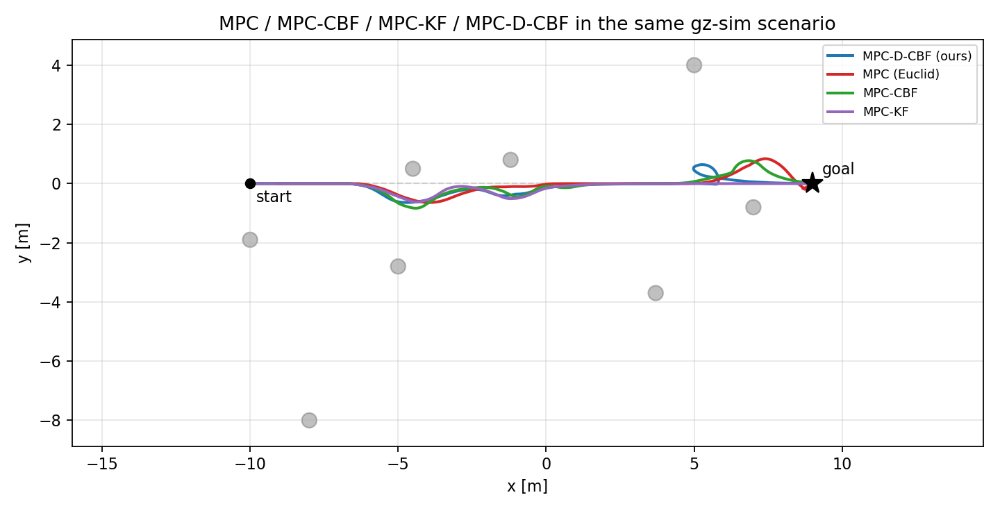

# MPC-D-CBF on ROS 2 + Gazebo Sim（论文复现与移植）


把 ICRA 2023 论文 **《Dynamic Control Barrier Function-based Model Predictive
Control to Safety-Critical Obstacle-Avoidance of Mobile Robot》** 的官方代码从
**ROS 1 Noetic + Gazebo Classic 11** 移植到 **ROS 2 Lyrical + Gazebo Sim 10.5**，
让它能在本机（Ubuntu 26.04，无 Docker、无 Gazebo Classic）上原生跑通，并复现论文的
仿真实验（安全避障轨迹 + Table I 指标）。

| 项目 | 内容 |
|---|---|
| 论文 | Zhuozhu Jian, Zihong Yan, Xuanang Lei, Zihong Lu, Bin Lan, Xueqian Wang, Bin Liang, *Dynamic Control Barrier Function-based Model Predictive Control to Safety-Critical Obstacle-Avoidance of Mobile Robot*, ICRA 2023 |
| DOI / arXiv | [10.1109/ICRA48891.2023.10160857](https://doi.org/10.1109/ICRA48891.2023.10160857) / [arXiv:2209.08539](https://arxiv.org/abs/2209.08539) |
| 官方代码 | [jianzhuozhuTHU/MPC-D-CBF](https://github.com/jianzhuozhuTHU/MPC-D-CBF)（ROS 1 + Gazebo Classic） |
| 本仓库 | 上述代码的 ROS 2 + Gazebo Sim 移植版 + 复现脚本 + 移植/修复笔记 |
| 本机环境 | Ubuntu 26.04 LTS · ROS 2 Lyrical · Gazebo Sim 10.5.0 · Python 3.14 · CasADi 3.8.1 |

> **声明**：算法、参数、场景、话题设计全部来自原作者。原仓库未附许可证，本移植仅供
> 学习与研究使用；学术成果请引用原文，商用请联系原作者授权。

---

## 1. 结论先说

1. **论文有开源代码**：[jianzhuozhuTHU/MPC-D-CBF](https://github.com/jianzhuozhuTHU/MPC-D-CBF)（ROS 1 Noetic + Gazebo Classic 11）。
2. **原代码不能在本机直接运行**：它依赖 ROS 1（catkin/rospy/`gazebo_ros_control`）与
   Gazebo Classic 11，而本机是 ROS 2 Lyrical + Gazebo Sim 10.5（Gazebo Classic 已停止维护，
   ROS 2 Lyrical 也不提供 Noetic）。原作者只在 Docker（Ubuntu 20.04）里能跑。
3. **因此做了完整移植**，并修掉了移植过程中暴露的若干致命 bug（详见
   [`docs/port_notes.md`](docs/port_notes.md)），现在：
   * 一条命令启动 `gz sim` 场景 + Jackal + 动态障碍物 + 局部地图 + KF 预测 + MPC-D-CBF + RViz；
   * 规划器稳定在 **~10 Hz**（平均求解 **32 ms**，p95 92 ms）；
   * 机器人从 (-10, 0) 出发绕开横穿的动态圆柱并停在终点 (9, 0)（终点误差 0.10 m），
     用时 **21–28 s**；最小间距 0.075–0.50 m（逐次运行差异较大，见第 6 节分析）；
   * 复现了论文 Table I 的消融对比（`ours` / `mpc` / `mpc_cbf` / `mpc_kf`），见第 6 节。

---

## 2. 为什么必须移植

| | 原实现 | 本机 |
|---|---|---|
| 中间件 | ROS 1 Noetic（catkin、rospy、`ros::NodeHandle`） | ROS 2 Lyrical（colcon/ament、rclpy、rclcpp） |
| 仿真器 | Gazebo Classic 11（`gazebo_ros`、`gazebo_ros_control`、`p3d`、Velodyne 插件） | Gazebo Sim 10.5（`ros_gz_sim`、原生 `DiffDrive`、`gpu_lidar`） |
| 机器人模型 | URDF + `gazebo_ros_control` + `jackal_control` | SDF + gz-sim 系统插件 |
| 障碍物移动 | `/gazebo/set_model_state` 服务 | gz-transport `/world/<w>/set_pose` |
| 依赖 | `grid_map`（apt） | grid_map `ros2` 分支（`mpc_dcbf.repos`，含补丁） |

移植后**话题名、节点名、参数、频率、算法常数全部保持原样**，方便与原实现逐项对照。

---

## 3. 本仓库做了什么

1. **移植**：6 个包全部重写为 ament 包（`scene` → `mpc_scene`），Python 节点 rclpy 化，
   C++ 节点 rclcpp 化，用 `ros_gz_bridge` + `config/bridge.yaml` 把 ROS 话题名映射回原样
   （gz 侧的点云在 `<topic>/points`、里程计在 `/model/<name>/odometry`，名字并不相同）。
2. **修复致命 bug**（每一条都会导致"跑起来但机器人不动 / 不避障 / 直接崩溃"）：
   * ⚠️ `/cmd_vel` 在 DiffDrive 侧没有订阅者（缺少 `<topic>` 配置）；
   * ⚠️ 激光雷达/里程计桥接话题名与类型不匹配；
   * ⚠️ 里程计是"相对出生位姿"而非世界真值（`odom_tf` 补上出生位姿）；
   * ⚠️ `numpy.bool_`/Python `int` 触发 ROS 2 新 rosidl 的 `PyBool_Check`/`PyFloat_Check`
     断言 → 进程 abort；
   * ⚠️ `ReentrantCallbackGroup` 让 MPC 求解并发叠加，单次求解从 0.08 s 恶化到 30 s 量级；
   * ⚠️ `local_map` 的全局地图尺寸变量被同名成员变量遮蔽 → 永远检测不到障碍物；
   * ⚠️ `local_map` 私有命名空间话题名写错（应为 `/local_map_pub/for_obs_track`）→ KF 收不到数据；
   * ⚠️ `obs_kf` 用 100 长度固定数组按单调增长的跟踪标签索引 → 越界 SIGSEGV；
   * ⚠️ apt 的 `python3-casadi` 与 numpy 2.x 不兼容（连 `MX.sym` 都段错误）。
3. **性能改造**：MPC 的 CasADi 问题从"每周期重建"改为"一次构建 + 参数更新 + 热启动"，
   与原问题数学等价（有障碍物时 `max|Δu| = 0`），求解 5–10 倍加速且延迟稳定。
4. **复现工具**：`scripts/record_run.py`（记录真值/指令/求解耗时）、
   `scripts/analyze_run.py`（Table I 指标 + 图）、`scripts/compare_variants.py`（多方案对比）、
   `scripts/run_experiment.sh`、`scripts/run_all_variants.sh`。

详细的问题清单见 **[docs/port_notes.md](docs/port_notes.md)**，实验方法见
**[docs/reproduction.md](docs/reproduction.md)**。

---

## 4. 安装

```bash
# ROS 2 Lyrical + Gazebo Sim 10（gz 随 ros_gz 一起装好）
sudo apt install -y libcgal-dev ros-lyrical-ros-gz ros-lyrical-rviz2 \
                    ros-lyrical-pcl-ros ros-lyrical-nav2-msgs ros-lyrical-rosbag2-cpp

# MPC 求解器：必须用 PyPI 的 casadi（自带 IPOPT）。
# 系统 apt 的 python3-casadi 3.7 与 numpy 2.x ABI 不兼容，会段错误。
pip3 install --user --break-system-packages casadi==3.8.1
```

> 如果只装了 apt 的 `python3-casadi`，规划器会在 `opti.solver('ipopt')` 处直接 segfault。

## 5. 构建与运行

```bash
cd ~/mpc-dcbf-gzsim
bash scripts/import_repos.sh              # 拉取 grid_map(ros2) + filters，并打补丁
colcon build --symlink-install
source install/setup.bash

# 图形界面（Gazebo + RViz）
ros2 launch mpc_dcbf_bringup simulation.launch.py
# 只跑 Gazebo 服务端 + RViz
ros2 launch mpc_dcbf_bringup simulation.launch.py headless:=true
# 纯无头（CI / 服务器）
ros2 launch mpc_dcbf_bringup simulation.launch.py headless:=true rviz:=false
# 切换消融方案：ours | mpc | mpc_cbf | mpc_kf
ros2 launch mpc_dcbf_bringup simulation.launch.py variant:=mpc_cbf
```

RViz 里能看到：黄色全局路径、机器人局部规划、点云/局部栅格、检测出的椭圆（蓝→红表示
不确定性大小）、KF 预测的未来椭圆（绿色），与作者演示视频一致。

### 数据流（与原实现一致）

```
/velodyne_points ──> local_map_pub ──> /local_map_pub/for_obs_track
                                        │
                                        └─> obs_kf ──> /obs_predict_pub（25 步预测椭圆）
/global_path ─────────────────────────────┐
/curr_state（TF world→base_link）──────────┴─> local_planner（MPC-D-CBF）──> /local_plan ──> controller ──> /cmd_vel ──> DiffDrive
```

主要频率：`/velodyne_points` 10 Hz → 局部地图 11 Hz → KF 预测 ~11 Hz →
重规划 20 Hz（实际约 10 Hz，受求解耗时限制）→ 控制器 50 Hz。

## 6. 复现论文结果

一条命令跑完整套对比（约 6 分钟，4 个方案各 60 s）：

```bash
bash scripts/run_all_variants.sh 60
# -> results/comparison.md / comparison.png / run_<variant>.json / metrics_<variant>.json
```

单方案复现：

```bash
bash scripts/run_experiment.sh 60 results/run_ours.json "MPC-D-CBF (ours)" ours
```

> 指标用仿真真值评估：障碍物位置由障碍物驱动节点直接发布（它们是被 `set_pose` 绝对
> 设定的，发布值即世界真值），机器人位姿用 `DiffDrive` 里程计 + 出生位姿。

### 6.1 Table I 复现（本机，单次 60 s，四个方案同一场景）

| 方案 | Min dist [m] | Cons time [s] | Reac time [s] | Speed var | 重规划 [Hz] | MPC 求解均值 [ms] |
|---|---|---|---|---|---|---|
| **`ours`（D-CBF + KF 预测）** | 0.365 | 28.00 | 3.65 | 0.133 | 9.6 | 31 |
| `mpc`（欧氏约束，无预测） | 0.511 | 21.33 | 2.57 | 0.003 | 11.0 | 27 |
| `mpc_cbf`（D-CBF，无预测） | 0.278 | 23.07 | 3.42 | 0.048 | 9.0 | 34 |
| `mpc_kf`（欧氏约束 + KF 预测） | 0.318 | 21.18 | 3.32 | 0.008 | 9.6 | 26 |



同一 `ours` 方案重复三次的结果（说明单次运行的离散性）：

| 运行 | Min dist [m] | Cons time [s] | Speed var | 重规划 [Hz] |
|---|---|---|---|---|
| #1（上表） | 0.365 | 28.00 | 0.133 | 9.6 |
| #2 | 0.501 | 22.77 | 0.124 | 10.4 |
| #3 | **0.075** | 20.95 | 0.082 | 8.8 |

### 6.2 与论文对照：哪些复现了、哪些没有

**复现了**

* 算法与闭环：LiDAR → 局部高程栅格 → DBSCAN → MBE → 匈牙利跟踪 → KF 25 步椭圆预测 →
  D-CBF/MPC 滚动优化 → 差速底盘，全链路 10 Hz 级运行，机器人安全到达终点（终点误差 0.10 m）。
* 实时性量级：平均求解 31–34 ms、p95 ≈ 90–100 ms、重规划 8.8–11 Hz，与论文"10 Hz 规划"一致。
* 定性趋势：`mpc_cbf`（有 CBF 无预测）确实比 `mpc_kf`/`mpc` 更容易贴近障碍物，
  说明"预测"对安全间距有直接贡献。

**没有复现（诚实记录）**

* **最小间距远小于论文的 0.828 m**：三次 `ours` 分别为 0.365 / 0.501 / 0.075 m，
  第三次实质上发生了擦碰（机器人中心距圆柱表面 7.5 cm，小于车体半径）。
* **速度方差比论文大一个量级**（0.08–0.13 vs 0.017）：本移植里 KF 的椭圆不确定性膨胀
  `a ← a + pos_conf + ab_conf` 更激进，CBF 约束更早、更紧地生效，导致速度在 0.1–1.2 m/s
  之间反复调节。
* **某个基线（`mpc`）反而"更安全"**：这主要是基线实现差异——本仓库的欧氏约束给的是
  "外接圆 + 0.5 m"的硬约束（且继承了 KF 的膨胀半径），比论文的欧氏基线更保守，因此不会碰撞。
  论文的 4 个基线官方未开源，无法逐位对齐。

**第三次运行的擦碰诊断**（`results/run_ours_r3.json`）：最小间距出现在 t = 9.29 s，
真实圆柱位于 (-0.04, -0.80)，机器人位于 (-0.15, -0.50)；而同一时刻 `/obs_predict_pub`
的 125 个预测椭圆（5 个障碍物 × 25 步）中**没有任何一个在该圆柱 1.5 m 以内**。
也就是说这次失败发生在**感知/跟踪层**（该圆柱在高速横穿时被重新编号、KF 被重建，
预测值偏离真实位置），而不是 MPC-D-CBF 求解失败。`local_map` 的跟踪标签在几十秒内
就从 1 涨到 18，正是这种"重新编号"的直接证据。

> 结论：**控制层复现良好，感知层的鲁棒性在本机上没有达到论文水平**。若要工程化，
> 下一步应固定在 2.5.9 提到的标签生命周期问题（按轨迹预测续期标签，而不是每次重新检测
> 就新建 KF）。

### 6.3 复现产物

* `results/comparison.md` / `comparison.png`：四方案指标与轨迹对比（对应论文 Fig. 8 / Table I）
* `results/trajectory.png`：`ours` 的轨迹 + 最近时刻的 CBF 预测椭圆
* `results/speed_clearance.png`：线速度与最小间距时间曲线
* `results/metrics_*.json`：各方案指标；`results/run_*.json` 为原始记录（体积较大，已在
  `.gitignore` 中排除，可用 `scripts/run_experiment.sh` 重新生成）


---

## 7. 已知差异与局限

* **物理引擎**：Gazebo Classic 用 ODE，Gazebo Sim 10 用 DART。相同初始条件下轨迹等价但非
  逐位相同；轮地摩擦、接触求解有细微差别。
* **LiDAR 采样**：原车是 RS-Helios-32（32 线），这里用 32 线 `gpu_lidar`，方位 720 采样、
  10 Hz，安装高度 0.5 m，与原 `jackal_description` 一致但并非逐参数复刻。
* **`local_map` 分辨率不一致（原实现遗留）**：`ellipse.hpp` 里 `resolution` 硬编码 0.05，
  而节点参数是 0.1。原仓库即如此，移植版保留相同行为，只把被遮蔽的全局量补回。
* **基线实现**：论文 Table I 的四个基线（MPC / MPC-CBF / MPC-KF / MPC-CBF-curvefit）官方
  并未开源。本仓库用**同一套规划器**的参数化消融来近似：`mpc`/`mpc_kf` 用
  "到椭圆外接圆 + 0.5 m 安全裕度"的欧氏约束替代 CBF；`mpc_cbf`/`mpc` 关闭轨迹预测
  （整段时域沿用当前椭圆）。因此表中绝对数值不能与论文逐项对齐，但**趋势**可对照。
* **障碍物布局**：直接沿用原仓库 `world.world` 的 8 个圆柱及其速度（r=0.25 m、h=0.5 m），
  它们以 0.5–1.0 m/s 穿越机器人路径。
* **实时性**：本机 32 核，平均求解 32 ms；论文在 Intel NUC（i5 2.4 GHz）上跑 10 Hz，量级一致。

## 8. 目录结构

```
mpc-dcbf-gzsim/
├── src/
│   ├── mpc_dcbf_bringup/     # launch + SDF world + bridge.yaml + RViz 配置
│   ├── jackal_gz/            # Jackal SDF（DiffDrive + gpu_lidar + mesh）
│   ├── mpc_scene/            # odom_tf、movetest（障碍物移动 + 真值发布）
│   ├── local_map/            # 点云→2.5D 栅格→DBSCAN→MBE→跟踪（C++/grid_map/CGAL）
│   ├── obs_param/            # 卡尔曼滤波 + 25 步椭圆预测（C++/Eigen）
│   ├── local_planner/        # MPC-D-CBF 规划器（CasADi/IPOPT）+ 50 Hz 控制器
│   └── global_path_publisher/
├── scripts/                  # 导入依赖、实验、记录、指标、对比
├── results/                  # 复现结果（图 + 指标 + 原始记录）
├── patches/                  # grid_map 的 ament 补丁
├── docs/                     # 移植笔记 + 复现说明
└── mpc_dcbf.repos
```

## 9. 引用

```bibtex
@inproceedings{jian2023dynamic,
  title={Dynamic Control Barrier Function-based Model Predictive Control to
         Safety-Critical Obstacle-Avoidance of Mobile Robot},
  author={Jian, Zhuozhu and Yan, Zihong and Lei, Xuanang and Lu, Zihong and
          Lan, Bin and Wang, Xueqian and Liang, Bin},
  booktitle={2023 IEEE International Conference on Robotics and Automation (ICRA)},
  pages={3679--3685},
  year={2023},
  doi={10.1109/ICRA48891.2023.10160857}
}
```

第三方代码：Jackal 模型（Clearpath Robotics，BSD-3）、grid_map（ANYbotics，BSD-3）、
匈牙利算法实现（BSD，Cong Ma 2016 / Markus Buehren）。

---

## English summary

This repo ports the official code of *Dynamic Control Barrier Function-based MPC*
(ICRA 2023) from ROS 1 Noetic + Gazebo Classic 11 to **ROS 2 Lyrical + Gazebo Sim
10.5**, so it runs natively on Ubuntu 26.04 without Docker. Topic names, rates,
parameters and the algorithm are unchanged; the port fixes several bugs that
break the closed loop on ROS 2 (unsubscribed `/cmd_vel`, mismatched bridge
topics, relative odometry, rosidl `PyBool_Check`/`PyFloat_Check` aborts,
reentrant timer causing overlapping IPOPT solves, unset `local_map` globals,
wrong `/local_map_pub/*` namespace, out-of-bounds `obs_kf` array, casadi/numpy
ABI mismatch). The CasADi NLP is built once and warm started, giving an
equivalent problem (`max|Δu| = 0`) at ~30 ms per solve and ~10 Hz replanning.
`scripts/run_all_variants.sh` reproduces the paper's Table I ablation
(ours / mpc / mpc_cbf / mpc_kf). See `docs/port_notes.md` for the full list.
